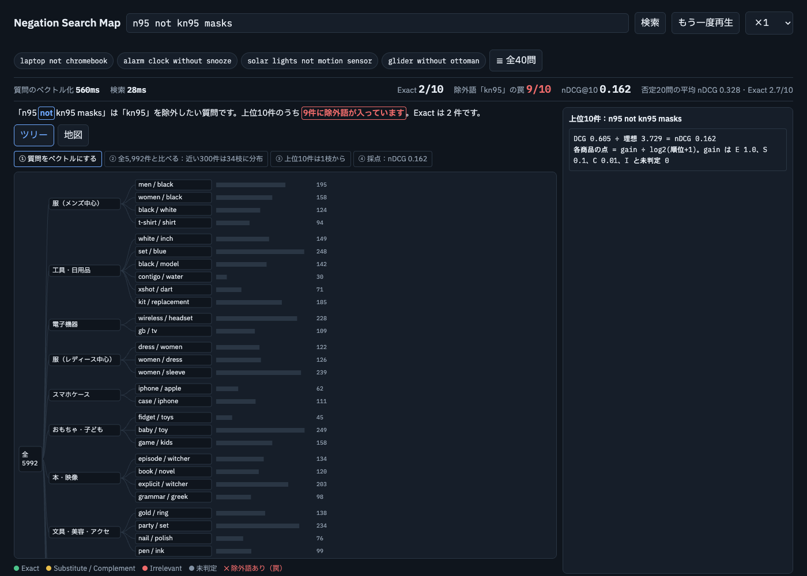

# ConstraintRAG

[English](README.md) | **日本語**

商品検索で、**否定や条件を含む質問**（例：「shampoo without sulfate」＝硫酸塩なしのシャンプー）を検索がどれだけ守れているかを測り、のちに直すためのプロジェクト。

状態：**v1（ベースラインの評価）＋ v0（RAG アプリのベースライン）**。2026年10月開始、作業中。個人の学習用プロジェクトで、ノートブックの分析コードは本人が書いています。`app/` のコードは AI（Claude）の手を借りて試作し、本人が読み直し・再現している途中です。

## 画面



検索結果ビューア（`viewer/index.html`）。否定を含む質問「n95 not kn95 masks」（KN95 ではない N95 マスク）で、**上位10件のうち9件に、除外したい「kn95」が入っている**（＝罠）。nDCG@10 は 0.162。ツリーは 5,992 件の商品がどこにあり、上位の結果がどの枝から来たかを示します。保存した v0 の結果から `app/src/export_viewer.py` で作っています。

## v1 でやったこと（ノートブック）
- データ：Amazon Shopping Queries Dataset（ESCI）、米国
- 検索：BM25、埋め込み検索（all-MiniLM）
- 指標：nDCG@10、上位10件の罠率（除外すべき商品が混ざった割合）。罠を「候補集めのせい」と「並べ方のせい」に分ける
- 検定：Mann-Whitney U、Wilcoxon の符号順位検定

## v0：RAG アプリのベースライン（`app/`）
否定に対して**特別なことは何もしない** LangGraph のパイプライン。わざと何もしないことで、失敗がそのまま見えるベースラインにしています。

```
contextualize → inspect → retrieve → generate → critic → record_history
```

### パイプラインの各ステップ（詳しく）
LangGraph では、1つの「状態（state）」の辞書が各ステップを順に通り、ステップごとに中身が足されていきます。v0 は分岐のない一直線です（`app/src/graph_router.py` の `build_graph`）。

| ステップ | 入るもの | すること | 足されるもの |
|---|---|---|---|
| `contextualize` | 質問・会話の履歴 | 「じゃあ黒いのは？」のような続きの質問を、単独で検索できる文に書き直す。**除外の条件は必ず残す**（`query_rewriting.py`） | 書き直した質問 |
| `inspect` | 書き直した質問 | 正規表現で否定を見つける（「without X」「X-free」「not X」など）。除外したい語を取り出す（`negation.py`） | 否定かどうか・除外語 |
| `retrieve` | 質問・除外語 | 質問をベクトルにし（BGE-M3）、ChromaDB で近い商品を上位10件取る。除外語を含む結果に `trap` の印を付ける。**並び順は変えない**（印を付けるだけ） | 検索結果・罠の印 |
| `generate` | 検索結果 | Gemini が検索結果だけを根拠に答えを書く | 答え |
| `critic` | 答え・検索結果 | 答えが根拠に支えられているかを確かめ、怪しい所に `⚠️ Check:` を付ける | 確認済みの答え |
| `record_history` | 全部 | 次の質問のために会話の履歴に残す | 履歴 |

ポイント：v0 は罠を**見つけるだけで直さない**。「否定を見つけるのは簡単でも、検索がそれを守れていない」ことを数字で見せるのが目的です。

### 評価の設定
- ESCI の **test** から 40 問：否定 20 問＋普通 20 問。どの比較でも同じ 40 問を使う
- 検索対象：この 40 問で評価済みの商品（約1,000件）＋ ESCI からランダムに 5,000 件 ＝ 5,992 件。ランダムの商品を混ぜて、本物のカタログに近づけている
- 指標：nDCG@10（ESCI のラベル。未評価の商品は 0 点）、trap@10、罠の下限（評価済みの候補を完璧に並べても避けられない罠の割合）

### 結果（質問ごとの平均）
| | nDCG@10 否定 | nDCG@10 普通 | trap@10 |
|---|---|---|---|
| v0 埋め込み検索 | 0.328 | 0.568 | 0.66（下限 0.20） |

否定の質問は普通の質問よりかなり低く、罠のほとんどは候補集めではなく**並べ方**から来ています（下限 0.20 に対して実際は 0.66）。

## v0 の上で試したこと（v0 のパイプラインには入っていない）

### 条件の層（`constraint_layer.py`）
商品画像の説明文（BLIP で作成、評価用の商品のみ）に除外語が入っている候補を外す（SQL、値はパラメータで渡す）。
- trap@10 0.66 → 0.605（Wilcoxon p=0.16）、nDCG@10 0.328 → 0.348（p=0.42）。有意差なし
- 限界：文字列の一致なので、説明文の中の否定を見ていない（「no hood」も「hood」として外してしまう）

### リランク（並べ直し）とは
検索は2段階に分けることが多いです。
1. **候補集め**：速い方法（埋め込み検索など）で、たくさん（ここでは上位100件）集める
2. **並べ直し（リランク）**：その100件だけを、もっと細かく見られるモデルで点数を付け直し、順番を入れ替える

候補集めは全商品を相手にするので速さ優先、リランクは少数だけなので重い判断ができる、という役割分担です。罠の多くが「並べ方のせい」だったので、リランクで罠を下に押し下げられないかを試しました。

### ML のリランク（`ml_reranker.py`、`ml_reranker_v2.py`）
ESCI の train の「質問×商品」の組で、ロジスティック回帰を学習（正解＝Exact かどうか）。埋め込み検索の上位100件を並べ直す。特徴量：質問とタイトル・説明文の TF-IDF の一致と単語。

| | nDCG@10 否定 | nDCG@10 普通 | trap@10 |
|---|---|---|---|
| 埋め込み（v0） | 0.328 | 0.568 | 0.66 |
| ロジスティック回帰（20万組） | 0.298 | 0.346（p=0.0003） | 0.625 |
| A：＋ランダムな負例（10万） | 0.324 | 0.438（p=0.017） | 0.76 |
| B：＋埋め込みの点数、特徴量4つ（2千） | 0.300 | 0.558（p=0.31） | 0.76（p=0.0015） |

どれも埋め込み検索に勝てず、A と B では罠が増えました。単語の一致や似ている度合いの特徴量は、**除外語を書いている商品ほど点を上げてしまう**ためです（「kn95 ではない」と言っているのに「kn95」と書いてある商品が「質問に似ている」と判定される）。A と B は学習の量も違うので、原因はまだ切り分けられていません。

### 画像の実験（試作）
いくつかの商品画像で CLIP の注目マップを見たところ、角や背景に注目していることが多く、まだ何も言えません。画像での検索は後の候補です。

## 次
- v1.1：物差しを直す（罠の判定、2択の nDCG、説明文の中の除外語も数える）
- v2：条件の違反を**意味で**見つけて（LLM・エージェント）、外すか並べ直す

## フォルダ
- `notebooks/01_eda.ipynb` – ESCI の否定の質問を見る
- `notebooks/02_baseline.ipynb` – BM25・埋め込みのベースライン
- `notebooks/03_eval.ipynb` – 評価と検定
- `notebooks/04_v15_rag.ipynb`、`notebooks/05_v11_metrics.ipynb` – 試しのノートブック
- `app/src/graph_router.py` – v0 の LangGraph パイプライン
- `app/src/negation.py` – 正規表現での否定の検出と罠の判定
- `app/src/rag_pipeline.py` – 埋め込み・Chroma の索引・検索・答えの生成
- `app/src/query_rewriting.py` – 続きの質問の書き直し
- `app/src/load_esci.py` – 検索対象と評価用の質問の読み込み
- `app/src/metrics.py` – nDCG・recall
- `app/src/eval_retrieval.py` – v0 の検索の評価（LLM なし）
- `app/src/constraint_layer.py`、`eval_constraint_layer.py` – 画像の説明文を使った条件の層
- `app/src/ml_reranker.py`、`ml_reranker_v2.py` – ML のリランクの実験
- `app/src/export_viewer.py`、`viewer/` – 検索結果ビューア
- `app/src/vision/` – 画像の取得・説明文・注目マップ
- `scripts/download_esci.py` – ESCI を `data/` に落とす（このリポジトリには含めていない）

## データとライセンス
ESCI のデータは**ここでは配布していません**。`python scripts/download_esci.py` で取得してください。
出どころ：[amazon-science/esci-data](https://github.com/amazon-science/esci-data)（Apache-2.0）。個人の学習のためだけに使っています。
