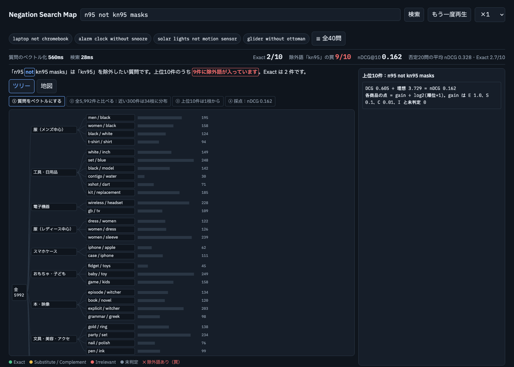

# ConstraintRAG

**English** | [日本語](README.ja.md)

Measuring (and later fixing) how retrieval handles **negated and constrained queries** in product search — e.g. "shampoo without sulfate".

Status: **v1 (baseline evaluation) + v0 (RAG app baseline)** — work in progress, started Oct 2026. This is a personal learning project; the analysis code in the notebooks is written by me. The `app/` code was prototyped with AI assistance (Claude) and is being reviewed and reproduced by me.

## What it looks like



Retrieval viewer (`viewer/index.html`, labels in Japanese) for the negated query "n95 not kn95 masks": 9 of the top 10 results still contain the excluded term "kn95" (trap), and nDCG@10 is 0.162. The tree shows where the 5,992 products sit and which branch the top hits come from. Generated by `app/src/export_viewer.py` from saved v0 results.

## v1 so far (notebooks)
- Data: Amazon Shopping Queries Dataset (ESCI), US locale
- Retrievers: BM25, dense embeddings (all-MiniLM)
- Metrics: nDCG@10, top-10 trap rate (negated items that should have been excluded), split into candidate-pool vs. ranking errors
- Significance tests: Mann-Whitney U, Wilcoxon signed-rank

## v0: RAG app baseline (`app/`)
A LangGraph pipeline that does **nothing special** about negation, so its failures stay visible as a baseline.

```
contextualize -> inspect -> retrieve -> generate -> critic -> record_history
```

### Pipeline steps in detail
In LangGraph, one state dictionary passes through the steps in order, and each step adds to it. v0 is a straight line with no branches (`build_graph` in `app/src/graph_router.py`).

| Step | Takes | Does | Adds |
|---|---|---|---|
| `contextualize` | query, chat history | Rewrites a follow-up ("what about black ones?") so it can be searched on its own. **Keeps every exclusion** (`query_rewriting.py`) | rewritten query |
| `inspect` | rewritten query | Detects negation with regular expressions ("without X", "X-free", "not X", …) and extracts the excluded term (`negation.py`) | is-negated flag, excluded term |
| `retrieve` | query, excluded term | Embeds the query (BGE-M3), takes the top 10 from ChromaDB, and flags results that contain the excluded term as `trap`. **The ranking is not changed** — it only flags | results, trap flags |
| `generate` | results | Gemini answers using only the retrieved results as evidence | answer |
| `critic` | answer, results | Checks whether the answer is supported by the evidence and marks doubtful parts with `⚠️ Check:` | checked answer |
| `record_history` | everything | Stores the turn for the next question | history |

Key point: v0 **finds traps but does not fix them**. The goal is to show in numbers that detecting a negation is easy, but retrieval still does not respect it.

### Example 1: `contextualize` (query rewriting)
Runs only when there is chat history; otherwise the query is returned unchanged (`contextualize_query` in `query_rewriting.py`). The LLM is told to:
1. Rewrite the request so it can be understood without the conversation
2. Replace references such as "that one" with the products they refer to
3. **Keep every exclusion the user stated**
4. Return it unchanged if there is nothing to replace

Illustrative example (made up for explanation, not a saved output):
```
History:        "n95 not kn95 masks"
Next question:  "any black ones?"
Rewritten:      "black n95 masks, not kn95"   <- the exclusion "not kn95" must survive
```
Note: the 40-query evaluation runs each query without history, so **this step does not affect the evaluation numbers** (queries go to retrieval unchanged).

### Example 2: `retrieve` and traps (actual result)
v0 top 10 for "n95 not kn95 masks" (from `results/eval_v0.json`):

| Rank | Product (start of title) | Contains kn95 |
|---|---|---|
| 1 | KN95 Face Mask 50 PCs, WWDOLL … | ✗ trap |
| 2 | WWDOLL KN95 Face Mask - 25 Pcs … | ✗ trap |
| 3 | KN95 Face Mask 50 PCs, WWDOLL … (another listing) | ✗ trap |
| 4 | KN95 Face Mask 25 PCs, WWDOLL … | ✗ trap |
| 5 | KN95 Disposable Face Mask - Miuphro … | ✗ trap |
| 6 | KN95 Face Mask, 20 Pack Black … | ✗ trap |
| 7 | KN95 Disposable Face Mask 25 Pack - Miuphro … | ✗ trap |
| 8 | KN95 Face Masks 30PCS, 5-Ply … | ✗ trap |
| 9 | 25pcs KN95 Face Mask Black … | ✗ trap |
| 10 | FANGTIAN **N95** Mask NIOSH Certified … | ○ |

trap@10 = 0.9, nDCG@10 = 0.162. The N95 mask the user wants appears **only at rank 10**.
Why: embeddings measure closeness in meaning, and "n95 not kn95 masks" and "KN95 Face Mask" are both about masks and share the word "kn95", so they look close. That "not" means "anything but" is barely reflected in vector similarity.
The trap floor for this query is 0.4: even a perfect ranking of the judged candidates keeps 40% traps (candidate-pool error). The other 0.5 comes from ranking.

### Evaluation setup
- 40 eval queries from the ESCI **test** split: 20 negated + 20 plain. The same 40 queries are used for every comparison
- Corpus: products judged for these queries (~1,000) + 5,000 random ESCI products = 5,992 products. The random products make retrieval closer to a real catalog
- Metrics: nDCG@10 (ESCI labels; unjudged products count as 0), trap@10, and trap floor (the trap rate that even a perfect ranking of the judged candidates cannot avoid)

### Results (mean over queries)
| | nDCG@10 negated | nDCG@10 plain | trap@10 |
|---|---|---|---|
| v0 dense retrieval | 0.328 | 0.568 | 0.66 (floor 0.20) |

Negated queries score much lower than plain ones, and most traps come from ranking rather than from the candidate pool (floor 0.20 vs. actual 0.66).

### In 30 seconds
"I measured how well retrieval respects exclusions in negated product-search queries. On 40 ESCI queries, negated queries reached nDCG@10 0.33 versus 0.57 for plain ones, and on average 66% of the top 10 contained the excluded product. Splitting traps into candidate-pool and ranking errors showed that most came from ranking. I tried reranking, but word-match features reward products that mention the excluded term, so it did not help. Next I will try detecting violations by meaning."

## Experiments on top of v0 (not part of the v0 pipeline)

### Constraint layer (`constraint_layer.py`)
Removes candidates whose image caption contains the excluded term (SQL with bound parameters). Captions were generated with BLIP for the eval-query products only.
- trap@10 0.66 → 0.605 (Wilcoxon p=0.16), nDCG@10 0.328 → 0.348 (p=0.42). Not significant
- Limitation: substring match, so it ignores negation in the caption ("no hood" is also removed)

### What reranking is
Search is often split into two stages:
1. **Candidate retrieval**: a fast method (e.g. dense search) collects many candidates (here, the top 100)
2. **Reranking**: a more detailed model rescores only those 100 and reorders them

Candidate retrieval runs over the whole catalog, so speed comes first; reranking sees only a few items, so it can afford heavier judgments. Since most traps came from ranking, I tested whether reranking could push traps down.

### ML reranker (`ml_reranker.py`, `ml_reranker_v2.py`)
Logistic regression on ESCI train query–product pairs (label: Exact or not), reranking the dense top 100. Features: TF-IDF query–title / query–description matches and words.

| | nDCG@10 negated | nDCG@10 plain | trap@10 |
|---|---|---|---|
| dense (v0) | 0.328 | 0.568 | 0.66 |
| logistic regression (200k pairs) | 0.298 | 0.346 (p=0.0003) | 0.625 |
| A: + random negatives (100k) | 0.324 | 0.438 (p=0.017) | 0.76 |
| B: + dense score, 4 features (2k) | 0.300 | 0.558 (p=0.31) | 0.76 (p=0.0015) |

Note: the result files (`ml_reranker*.json`) store only mean scores, not **how the ranking changed per query**. Showing a before/after example requires re-running the experiments with the top 10 saved (TODO).

None beat dense retrieval, and the trap rate got worse in A and B: word-match and similarity features reward products that mention the excluded term (a product titled "KN95" looks similar to "n95 not kn95"). A and B also differ in training size, so the causes are not separated yet.

### Image experiments (prototype)
CLIP attention maps on a few product images; attention often lands on corners and background, so nothing can be concluded yet. Image-based retrieval is a possible later step.

## Next
- v1.1: fix the metrics (trap check, binary nDCG, excluded terms in descriptions)
- v2: detect constraint violations by meaning (LLM / agent) and remove or rerank

## Layout
- `notebooks/01_eda.ipynb` – exploring negated queries in ESCI
- `notebooks/02_baseline.ipynb` – BM25 / embedding baselines
- `notebooks/03_eval.ipynb` – evaluation and significance tests
- `notebooks/04_v15_rag.ipynb`, `notebooks/05_v11_metrics.ipynb` – trial notebooks
- `app/src/graph_router.py` – the v0 LangGraph pipeline
- `app/src/negation.py` – regex negation detection and trap check
- `app/src/rag_pipeline.py` – embeddings, Chroma index, search, answer generation
- `app/src/query_rewriting.py` – follow-up query rewriting
- `app/src/load_esci.py` – corpus and eval-query loading
- `app/src/metrics.py` – nDCG / recall
- `app/src/eval_retrieval.py` – v0 retrieval evaluation (no LLM)
- `app/src/constraint_layer.py`, `eval_constraint_layer.py` – caption-based constraint layer
- `app/src/ml_reranker.py`, `ml_reranker_v2.py` – ML reranker experiments
- `app/src/export_viewer.py`, `viewer/` – retrieval viewer
- `app/src/vision/` – image fetching, captions, attention
- `scripts/download_esci.py` – downloads ESCI into `data/` (not included in this repo)

## Data and license
The ESCI data is **not redistributed here**. Get it with `python scripts/download_esci.py`.
Source: [amazon-science/esci-data](https://github.com/amazon-science/esci-data) (Apache-2.0). Used for personal study only.
